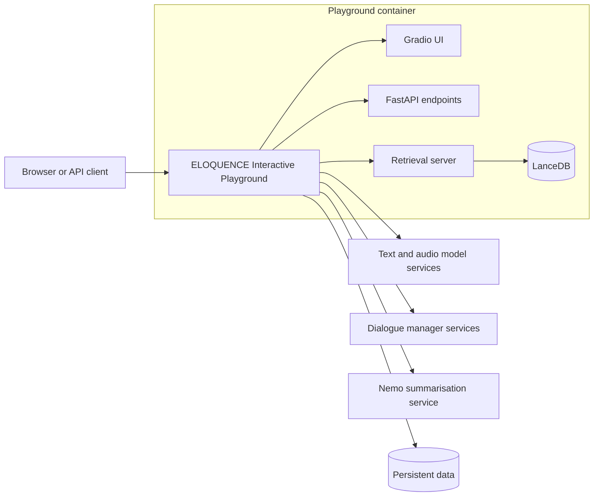

# ELOQUENCE Interactive Playground

ELOQUENCE Interactive Playground is a Gradio application for testing text and
audio language-model services through a single interface. It supports ordinary
chat, retrieval-augmented generation (RAG), document ingestion, transcription,
speaker diarization, audio question answering, specialised dialogue systems and
conversation summaries with attention visualisation.

The playground does not normally load the conversational models itself. Models
and specialised components run as external services and are registered in the
application configuration. The playground coordinates requests, stores user
workspaces and connects the selected task to the appropriate service.

## Main features

| Feature | Description |
| --- | --- |
| Basic LLM | Chat with any configured text model that is available to the playground. |
| RAG | Retrieve relevant chunks from a selected vector index and include them as evidence for the model. |
| Document ingestion | Create and update LanceDB indexes from supported documents or structured conversation chunks. |
| Audio QA | Ask questions using audio, either with a speech-capable model or through transcription followed by a text model. |
| Transcription | Transcribe uploaded or recorded audio with configured ASR services such as Whisper or MEUSLI. |
| Diarization | Transcribe audio and separate speakers using a configured WhisperX service. |
| SDialog | Use a specialised dialogue model through the same playground interface. |
| Dialogue manager | Connect to task-specific dialogue managers, including the English and Serbian NurseLLM services. |
| Summarisation | Generate a summary of a text conversation with the external Nemo attention service. |
| Attention visualisation | Select text in a summary to highlight the related parts of the conversation. |
| Speaker reconciliation | Reconcile speaker labels across separately ingested conversation chunks. |
| Saved workspaces | Store prompts, conversation histories, feedback and retriever selections per user. |
| HTTP API | Access the same task execution and ingestion workflows programmatically. |

The Gradio task selector exposes the stable interactive tasks. Some additional
task configurations may exist for API clients while they are still under
development.

## Architecture



The main application is implemented with Gradio mounted on FastAPI. Browser
interactions and HTTP API requests therefore use the same task handlers and model
registry.

The retrieval server manages document ingestion, embeddings and similarity
search over LanceDB. It runs alongside the playground in the standard container
setup. Conversational models, speech services, dialogue managers and the Nemo
summarisation service run independently and are reached through their configured
HTTP endpoints.

Persistent data is mounted at `/data` in the container. It contains the runtime
configuration, vector indexes, user workspaces, feedback and speaker registries.

## Configuration

Runtime configuration lives under `playground-data/configurations/`:

| Path | Purpose |
| --- | --- |
| `models.json` | Model and service names, interactors, endpoints, interfaces and optional credentials. |
| `retrievers.json` | Available retrieval services. |
| `indexes.json` | Known vector indexes and their embedding models. |
| `prompts.json` | Shared saved prompts. |
| `task_configs/` | Task definitions, required interfaces and whether retrieval is enabled. |

General defaults and environment-backed settings are defined in `settings.py`.
Model credentials should be supplied through environment variables or deployment
secrets rather than committed to the repository.

Each model entry declares an `interface`, such as `text`, `audio` or `service`,
and an `interactor` that selects the client implementation. Gradio filters the
available models according to the selected task and the services that are
reachable.

## Using the Gradio application

The interface has three main tabs:

### Playground

1. Select a **Task configuration**.
2. Select one of the compatible models shown for that task.
3. For RAG, select the vector store, index and number of documents to retrieve.
4. Optionally change the system prompt and generation parameters.
5. Enter text, upload audio or record audio, depending on the selected task.
6. Submit the request and continue the conversation from the same history.

The configuration panel contains the system prompt, temperature, top-p,
maximum output tokens and RAG top-k controls. Their visibility depends on the
selected task. Prompts and conversation histories can be saved and restored from
the same interface.

The **Summarization** and **DM** tasks display a summary control. The summary is
generated by the external Nemo service. Selecting a span in the rendered summary
highlights the conversation tokens associated with that span by the returned
attention data.

### Ingestion

The ingestion tab creates or extends a vector index. Select the target vector
store, provide an index name, choose an embedding model, upload the documents and
select a splitting strategy. Chunk length is used by length-based strategies;
the percentile threshold is used by semantic splitting.

### Feedback

The feedback tab displays stored user feedback, supports filtering and allows the
resulting data to be downloaded.

## RAG and ingestion

The RAG workflow has two stages:

```text
Document -> text extraction -> chunking -> embeddings -> LanceDB index
Question -> query embedding -> similarity search -> selected chunks -> model
```

The ingestion pipeline supports PDF, DOCX, CSV, TSV, HTML, Markdown, plain text
and JSONL files. It provides simple, recursive and semantic splitting strategies.
Each index records the embedding model used when it was created so that queries
use the same representation.

At query time, the retrieval server embeds the question, performs vector search
and returns the most relevant chunks with their distances and metadata. The
playground formats those chunks as evidence and sends them to the selected model.
The answer can reference the retrieved documents, which are also returned by the
API and shown by the interface where applicable.

Structured conversation ingestion can append ordered chunks to an index. Speaker
reconciliation uses previous chunk metadata to keep speaker identities consistent
across independently processed audio segments.

## Wikipedia and MCP

Wikipedia support is available through the `/query` API but is currently hidden
from the Gradio task and model selectors. It provides two task configurations:

- `Wiki` sends the conversation to the external agent configured as
  `Gemma + Tools`. The agent decides whether to call Wikipedia and returns its
  final answer.
- `RAG_with_Wiki` retrieves local conversation chunks and runs a tool loop that
  prioritises those chunks while using Wikipedia for complementary general
  knowledge. Local and Wikipedia evidence remain explicitly separated.

The integration uses an external agent endpoint on port `9084` and a Wikipedia
MCP server on port `8888`. MCP exposes `search_wikipedia`, `get_summary` and
`get_article`; the model selects a tool with `tool_choice=auto`. Both loops allow
at most eight model calls and reserve the last call for a final answer without
tools. The MCP server caches repeated requests and article content is capped
before it is returned to the model. `RAG_with_Wiki` additionally turns temporary
MCP failures into tool results so they do not abort the whole `/query` request.

The agent and MCP services are deployed separately from this repository. Their
URLs and model endpoints must be adapted to the target environment.

## Deploy with docker compose

### Prerequisites

Make

[Docker](https://docs.docker.com/engine/install/ubuntu/)

[Docker compose](https://docs.docker.com/compose/install/)

### Environment Variables

To run this project, you will need to add the following environment variable to
your `.env` file:

`OPENAI_API_ENDPOINT_URL`

Example `.env` file:

```bash
OPENAI_API_ENDPOINT_URL=http://172.17.0.1:8080/v1/completions
```

## Deployment (docker compose)

To deploy, run:

```bash
make deploy
```

To delete the deployment, run:

```bash
make undeploy
```

To stop the deployment, run:

```bash
make stop
```
